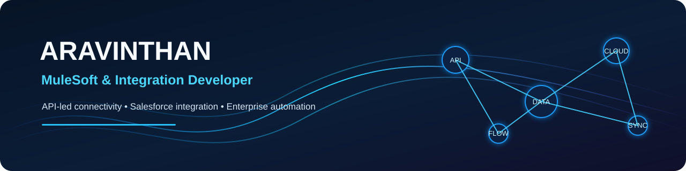

# Aravinthan — MuleSoft & Integration Developer

> Building connected experiences through API-led connectivity, Salesforce integration and enterprise automation.

## About

I work on integration-focused solutions using MuleSoft and Salesforce, with an interest in reliable APIs, data movement and process automation.

- **Focus:** Mule 4, Anypoint Platform, API-led connectivity and Salesforce integration
- **Integration patterns:** Batch processing, file-based integration and system connectivity
- **Engineering interests:** API design, data transformation, monitoring and resilient integrations

## Technology

**Integration:** MuleSoft, Mule 4, Anypoint Platform, RAML  
**CRM:** Salesforce, Apex, Lightning Web Components  
**Data:** MySQL, Snowflake, SQL  
**Engineering tools:** Git, GitHub, Postman, Jenkins

## Featured work

| Project | Focus |
|---|---|
| [API-Led-Connectivity](https://github.com/Aravinthan17-IN/API-Led-Connectivity) | API-led integration concepts |
| [Mule-Salesforce](https://github.com/Aravinthan17-IN/Mule-Salesforce) | MuleSoft and Salesforce integration |
| [Mule-Batch_Processing](https://github.com/Aravinthan17-IN/Mule-Batch_Processing) | CSV-to-Salesforce batch processing |
| [mule-file-relay](https://github.com/Aravinthan17-IN/mule-file-relay) | File relay implementation |

## Connect

- GitHub: [@Aravinthan17-IN](https://github.com/Aravinthan17-IN)
- LinkedIn: [Add your LinkedIn profile URL]
- Email: [Add a professional contact email]

---
*This profile highlights practical integration work. Project-specific implementation details are documented in each repository.*